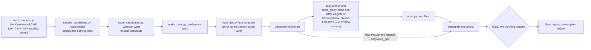

# gatedtrain recipe: Fun-CosyVoice3-0.5B DPO for text-to-speech

This recipe teaches a zero-shot voice-cloning text-to-speech model to make fewer reading errors, and lets
[gatedtrain](https://github.com/gatedtrain/gatedtrain) decide whether the trained model really is better than the one
it started from. It runs direct preference optimization (DPO) of the speech-token language model of
Fun-CosyVoice3-0.5B, with preference pairs ranked by the word error rate (WER) that Whisper-large-v3-turbo measures on
sampled candidates. The flow-matching decoder and the vocoder are not trained. gatedtrain compares the DPO weights
against the base `llm.pt` on 450 held-out hard-text items, by a rule registered before training: per-item WER of a
different ASR (Qwen3-ASR-1.7B) decides (superiority), and the speaker similarity of the output to the voice prompt
(SpeechBrain ECAPA) is a blocking non-inferiority guard.

A recipe is a ready-made external run for gatedtrain: the training code with its locked environment, plus an
*adapter*, the small plugin through which gatedtrain reads the run's outputs. gatedtrain does not start the training;
you run it.

This is a prototype: the result below is one registered run, not a benchmark claim.

## How it works



`gatedtrain ext-launch` checks the run request and prints the container command; you run it (`launch/tts.sh` goes
through the steps). The steps, flags and arm files are explained in gatedtrain's
[External runs](https://gatedtrain.github.io/gatedtrain/external-runs/) guide.

## Result

Result (2026-11-18): **PASS**. The run was launched with `ext-launch` and collected with `ext-collect` of ptc-hub 0.2.0,
the project's name before gatedtrain 0.3.0 (adapter `cosyvoice_dpo`, two-clause registration in design revision 18
form), and re-judged with gatedtrain 0.3.0 under a version-only amendment with every statistic equal. The candidate is
the last cut of a 104-step DPO run; the whole recipe took 3.00 GPU-hours on one RTX 4090. Both clauses are blocking, on
450 held-out items:

| Clause | Metric | Base | DPO | Gate |
|---|---|---|---|---|
| quality: superiority | `wer_qwen_canon` (Qwen3-ASR-1.7B, lower is better) | 0.1078 | 0.0708 | **PASS**: improvement 0.0370, 95% interval [0.0250, 0.0496] |
| speaker_guard: non-inferiority, margin 0.01 | `sim_prompt` (ECAPA cosine to the voice prompt, higher is better) | 0.8378 | 0.8393 | **PASS**: +0.0015, 95% interval [-0.0028, +0.0081] |

An earlier run of the same recipe (2026-11-17), decided by the recipe's own analysis script and not collected by the
framework, also passed (`wer_qwen_canon` 0.1078 to 0.0701, `sim_prompt` 0.8378 to 0.8390); `RESULT.md` keeps it and the
disclosures. It also has both runs' verdicts, the checkpoint selections on the dev set and the GPU hours. A pass means
fewer ASR-judged reading errors on these texts, not a general naturalness gain; naturalness was not measured.

The files under `results/2026-11-18/` (except the amendment files `gate/*-gatedtrain.yaml`) are byte copies of the run's files (the registration's SHA-256 is the one
the gate report pins), except two with host paths replaced by `<runtime>` and `<out>`: `records/selection.json`
and `records/test-rl.summary.json` (the originals are not published). The run's manifests
and its evaluation copies carry host paths and are not included; the per-item arms are (`arms-test-*/`).

For the earlier run: `RESULT.md` also has the amendment made before any test metric was looked at. The files under
`results/2026-11-17/` are copies with host paths replaced
by `<runtime>` (this repository's `runtime/`) and `<out>` (the run output directory), and one comment of
`registration-v2.yaml` reworded; the values are unchanged. The gate-time originals are not published, except
`gate/registration.yaml` and `evidence/dpo-train-k6/train_log.jsonl`, which are unchanged. The training and reward
metadata (`evidence/dpo-train-k6/train_meta.json`, `evidence/reward-train-k6/reward_meta.json`) were removed from the
publication because they recorded hashes of unpublished originals.

`runtime/items-hard-test/item_set_meta.json` and `runtime/items-hard-dev/item_set_meta.json` had absolute paths in
`checked_disjoint_from[].dir`, now relative (the originals are not published); the registered item-set hash is that
of `items.jsonl`, which is unchanged. Every runtime script is byte-identical to the one the run executed.

## Setup

```bash
pip install "gatedtrain @ git+https://github.com/gatedtrain/gatedtrain@v0.3.0"   # the framework, at the release this recipe was tested with
pip install -e .                                     # the package and its adapter, into an environment with gatedtrain
cd runtime
uv sync --frozen                                     # main environment (.venv)
(cd eval && uv sync --frozen)                        # evaluator environment (eval/.venv)
./fetch_cosyvoice.sh                                 # CosyVoice source at the pinned commit into src/CosyVoice (network)
.venv/bin/python fetch_models.py                     # four models and LibriTTS-R at pinned revisions (network)
```

`fetch_models.py --verify` re-hashes every downloaded file against `models/MODELS.json` and `data-source/DATA.json`.
For launches under gatedtrain, `runtime/prepare_gatedtrain_runtime.sh` then readies the runtime for a read-only mount.
Weights, audio, the CosyVoice source and run outputs are not committed (`.gitignore`). The run scripts write under
`runtime/out/` (or `GATEDTRAIN_RECIPE_COSYVOICE_DPO_TTS_OUT`); `runtime/README.md` has the steps, the pins and the GPU cost.
The package locates `runtime/` from its source tree, so with a non-editable install (a wheel) set
`GATEDTRAIN_RECIPE_COSYVOICE_DPO_TTS_RUNTIME` to a checkout's `runtime/` directory. `launch/tts.sh` reads
`GATEDTRAIN_RECIPE_COSYVOICE_DPO_TTS_{OUT,RUNTIME,IMAGE,SPEC}` and `GATEDTRAIN_RECIPE_PYTHON`.

## Layout

| Path | What |
|---|---|
| `src/gatedtrain_recipe_cosyvoice_dpo_tts/` | `pins.py`: the SHA-256 of every runtime script and item set, the LLM weights of the published run's three arms, and the source revisions; the gatedtrain adapter `cosyvoice_dpo` (`rows.py`, `adapter.py`, registered through the `gatedtrain.adapters` entry point); `arms.py` (score_tts.py output to gatedtrain arms), `smoke.py` (the smoke record), `select.py` (the pre-registered dev selection), `launch.py` (ext-launch requests) |
| `launch/tts.sh` | the rerun under gatedtrain, step by step (requests, launch records and gpu-step.sh commands; host steps) |
| `launch/gate/` | the registration template (without `created_at`) and spec template; the frozen copies of the 2026-11-18 run are in `results/2026-11-18/gate/` |
| `launch/image/` | the Dockerfile of the launch image (CUDA base plus `ffmpeg`, which score_tts.py needs; its RUN instruction still writes `/etc/ptc-a11-packages.txt`, a file name kept from the project's earlier name so that the instruction stays byte-identical to the one that built the published rerun's image, pinned by digest) |
| `runtime/` | the main environment (`pyproject.toml`, `uv.lock`: CosyVoice, torch 2.5.1, transformers 4.51.3) with `gen_tts.py`, `sample_candidates.py`, `make_pairs.py`, `train_dpo.py`, `eval_arm.py`, `analyze_gate.py`, the item builders `make_hard_items.py`, `make_items.py`, the fetch scripts `fetch_models.py`, `fetch_cosyvoice.sh`, `prepare_gatedtrain_runtime.sh`, the published run's scripts `run_*.sh`, the item sets `items-*/`, the pin manifests `models/MODELS.json`, `data-source/DATA.json`, and its unit tests `tests/` |
| `runtime/eval/` | the evaluator environment (its own `pyproject.toml`, `uv.lock`: Qwen3-ASR, SpeechBrain, torch 2.8.0, transformers 4.57.6) with `score_tts.py` (gate scoring), `score_candidates.py` (the DPO reward) and `wer_canon.py` |
| `tests/` | the recipe's tests: pins against the checkout and the run records, consistency of the gate files, byte-copied rows of real score outputs (`tests/fixtures/area11/`); the adapter's conformance, cuts, identity, consumption and checks, a whole `ext-collect` and `ext-launch` on synthetic runs (`tests/_tts.py`, `tests/fixtures/tts/`), the arm converter, the smoke record and the selection |
| `results/2026-11-18/` | the run collected by ptc-hub 0.2.0: frozen registration and spec (`gate/`, with the gatedtrain 0.3.0 amendment `registration-gatedtrain.yaml` and `spec-gatedtrain.yaml`), gate report, plan, lockfile, smoke record, consumption ledger and lineage edges (`ptc-run/`, the run directory's name from the project's earlier name), per-item test arms (`arms-test-base/`, `arms-test-cand/`), dev selection and rl summary (`records/`); host paths in `records/` are replaced by `<runtime>` and `<out>` |
| `results/2026-11-17/` | the gate registrations (`gate/registration.yaml`, `gate/registration-v2.yaml`) and small run records (`evidence/`: gate result, candidate and pair metadata, training log, dev and test summaries) |

## Tests

```bash
python -m unittest discover -s tests -t tests                                   # the recipe's tests (no model, CPU)
cd runtime
CUDA_VISIBLE_DEVICES= .venv/bin/python -m unittest discover -s tests -t tests -p 'test_main_*.py'
CUDA_VISIBLE_DEVICES= eval/.venv/bin/python -m unittest discover -s tests -t tests -p 'test_eval_*.py'
```

The runtime tests run on CPU with a tiny randomly initialised CosyVoice3 LLM; they need `src/CosyVoice`
(`fetch_cosyvoice.sh`), and the evaluator tests need Whisper's `normalizer.json` (`fetch_models.py --models`).

The gate files under `results/` and `RESULT.md` refer to the maintainers' decisions (for example the 2026-11-17
decision that the amendment is not post hoc); the record of those decisions is not published.

## Data and licenses

| Component | Pin | License | Attribution and use here |
|---|---|---|---|
| Fun-CosyVoice3-0.5B-2512, `FunAudioLLM/Fun-CosyVoice3-0.5B-2512` (incl. its `CosyVoice-BlankEN` text LM) | revision `29e01c4e8d000f4bcd70751be16fa94bf3d85a18`; files and SHA-256 in `runtime/models/MODELS.json` | Apache-2.0 (the model card's `license` at that revision) | FunAudioLLM, CosyVoice 3. Downloaded, not redistributed; the DPO weights are derived from its `llm.pt`. |
| CosyVoice source code, `github.com/QwenAudio/CosyVoice` (with the Matcha-TTS submodule, `github.com/shivammehta25/Matcha-TTS`) | commit `074ca6dc9e80a2f424f1f74b48bdd7d3fea531cc` (Matcha-TTS `dd9105b34bf2be2230f4aa1e4769fb586a3c824e`) | Apache-2.0 (CosyVoice `LICENSE`); MIT (Matcha-TTS `LICENSE`, Copyright (c) 2023 Shivam Mehta) | Cloned by `runtime/fetch_cosyvoice.sh` and imported; not vendored, no code ported. `train_dpo.py` is an own implementation (its docstring says how it differs from the upstream `forward_dpo`). |
| LibriTTS-R (OpenSLR 141): `train_clean_100`, `dev_clean`, `test_clean` | archives and md5 in `runtime/data-source/DATA.json` | CC BY 4.0 (the corpus `LICENSE.txt`: "made available by Google LLC under a Creative Commons Attribution 4.0 International License") | Koizumi et al., "LibriTTS-R: A Restored Multi-Speaker Text-to-Speech Corpus" (Interspeech 2023), https://www.openslr.org/141/. **Redistributed:** transcripts and speaker ids in `runtime/items-*/items.jsonl` (voice-prompt transcripts and natural sentences). Audio is not committed. See `THIRD_PARTY_NOTICES.md`. |
| Whisper large-v3-turbo, `openai/whisper-large-v3-turbo` | revision `41f01f3fe87f28c78e2fbf8b568835947dd65ed9` | MIT (the model card's `license` at that revision) | The ASR of the DPO reward; reported, never deciding. Downloaded, not redistributed. |
| Qwen3-ASR-1.7B, `Qwen/Qwen3-ASR-1.7B` | revision `7278e1e70fe206f11671096ffdd38061171dd6e5` | Apache-2.0 (the model card's `license` at that revision) | The deciding ASR; never used for training or for building pairs. Downloaded, not redistributed. |
| SpeechBrain ECAPA-TDNN speaker embeddings, `speechbrain/spkrec-ecapa-voxceleb` | revision `0f99f2d0ebe89ac095bcc5903c4dd8f72b367286` | Apache-2.0 (the model card's `license` at that revision) | The speaker-similarity guard. Downloaded, not redistributed. |
| frozendict 2.5.1 | `runtime/uv.lock` (a dependency of the runtime's locked packages) | LGPL-3.0 | Installed by `uv sync --frozen`, not redistributed. |
| torch, transformers, qwen-asr, speechbrain, jiwer and the other locked packages | `runtime/uv.lock`, `runtime/eval/uv.lock` | their own licenses | Installed by `uv sync --frozen`, not redistributed. |

## Responsible use

This recipe trains and runs a zero-shot voice-cloning text-to-speech model: from a few seconds of someone's recorded
speech it can produce new speech in that voice. Use it, and anything trained with it, only with care:

- Do not clone a person's voice without that person's consent, and do not use generated speech to impersonate anyone or
  to deceive (fraud, misinformation, bypassing voice authentication, or putting words in someone's mouth).
- Label generated audio as synthetic wherever it is published or shared.
- Follow the CosyVoice project's own terms. Its README at the pinned commit
  (https://github.com/QwenAudio/CosyVoice/blob/074ca6dc9e80a2f424f1f74b48bdd7d3fea531cc/README.md, section
  "Disclaimer") states: "The content provided above is for academic purposes only and is intended to demonstrate
  technical capabilities. Some examples are sourced from the internet. If any content infringes on your rights, please
  contact us to request its removal." The code is Apache-2.0 and the Fun-CosyVoice3-0.5B-2512 weights are Apache-2.0
  per their model card; check the model card and the voice data's license (here LibriTTS-R, CC BY 4.0) for your use.
- Comply with the laws that apply to synthetic media, voice likeness and personal data where you use it.

The voices in this recipe are LibriTTS-R speakers (public-domain audiobook readings, released under CC BY 4.0), used
only to measure reading accuracy and speaker similarity.

## License

Licensed under the Apache License, Version 2.0 (`LICENSE`); see `NOTICE`. This covers the recipe's code and documents;
third-party data keeps its own license (above), and the third-party material in this repository (LibriTTS-R
transcripts and speaker ids, and fixtures derived from them) is listed with its source and license in
`THIRD_PARTY_NOTICES.md`.

Names of third-party projects and products are trademarks of their owners; this project is not affiliated with or
endorsed by them.
